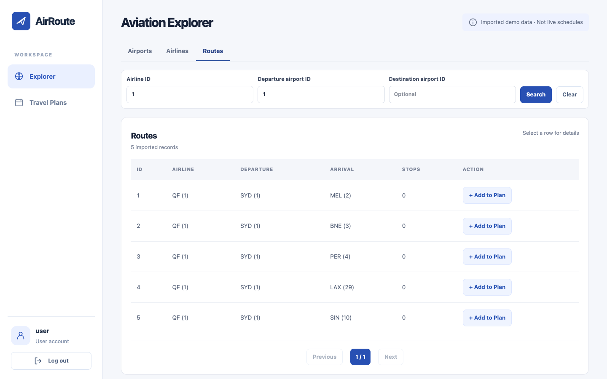
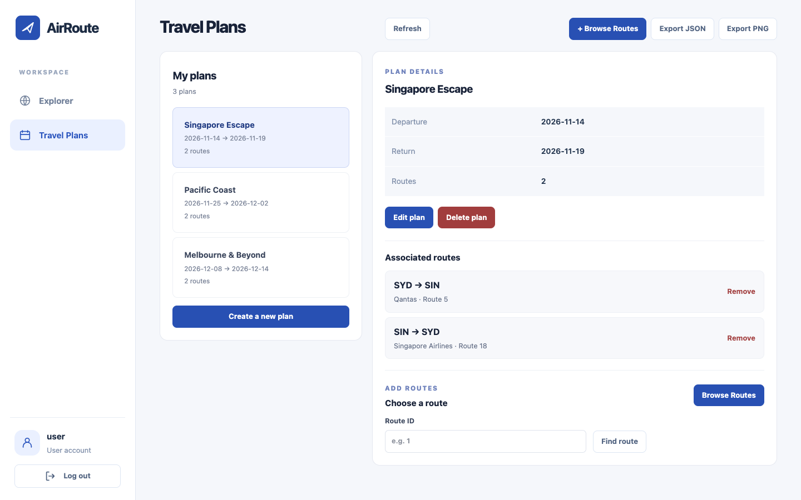
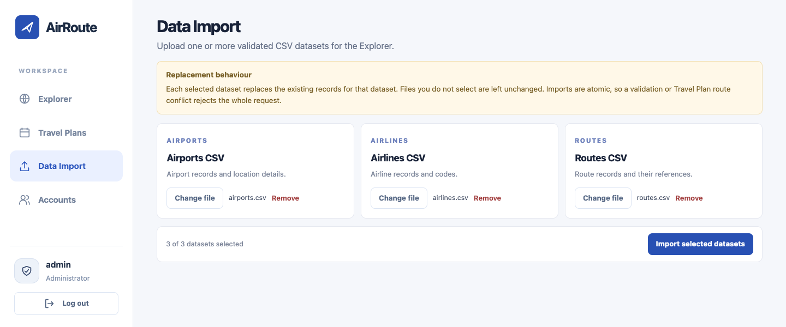
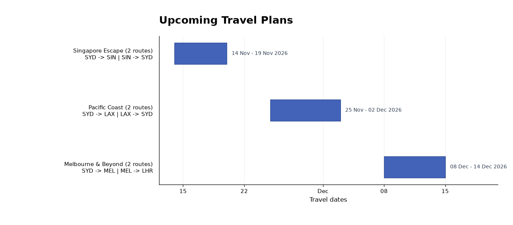
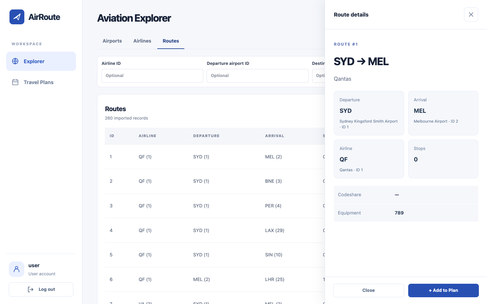

# AirRoute

Explore airline networks and organise personal travel plans.



AirRoute is a local full-stack application for browsing imported airport,
airline and route data, saving routes to private travel plans, and exporting
upcoming trips. Aviation records are demonstration data, not live flight schedules.

## Features

- JWT login with User and Admin roles
- Searchable, paginated airport, airline and route explorer with non-modal details
- Private travel-plan CRUD with route associations
- JSON exports and PNG timelines for upcoming plans
- Admin CSV imports with validation, atomic replacement and route protection
- Admin account creation, activation, deactivation and deletion
- Swagger/OpenAPI documentation for the Flask API

## Application preview

Captured from the real React frontend and Flask API using an isolated SQLite
database populated with the repository's CSV fixtures. The temporary User account
owns all three demonstration plans; each contains two valid routes.
Select a gallery image to view it at full resolution.

| Travel Plans | Admin Data Import |
| --- | --- |
| [](docs/screenshots/travel-plans.png) | [](docs/screenshots/data-import.png) |
| Manage saved routes, browse the network, and export plans. | Select airport, airline and route CSVs with clear replacement rules. |

### Upcoming travel timeline

The unmodified PNG returned by `GET /travel-plans/export?format=image`, showing
three future plans and their associated routes.



<details>
<summary>Route Details: inspect a route while keeping the table accessible</summary>

The non-modal drawer keeps the table at normal brightness and offers Add to Plan.



</details>

## Stack and structure

- **Backend:** Python 3.13, Flask, Flask-RESTX, SQLAlchemy, SQLite
- **Frontend:** React, TypeScript, Vite
- **Authentication:** Flask-JWT-Extended and hashed passwords
- **PNG export:** Matplotlib
- **Tests:** pytest, requests, frontend TypeScript/ESLint checks

```text
backend/airroute/   Flask application, API resources, services and models
backend/tests/      Isolated unit and HTTP regression tests
frontend/src/       React application and API client
docs/               Project and API documentation
```

## Local setup

Prerequisite: Python 3.13 and Node.js/npm.

```bash
python3.13 -m venv .venv
.venv/bin/python -m pip install -e ".[dev]"
cd frontend
npm install
```

Start the backend from the project root:

```bash
PYTHONPATH=. .venv/bin/python backend/run.py
```

The API and Swagger UI are available at <http://127.0.0.1:5000/>.

In a second terminal, start the frontend:

```bash
cd frontend
npm run dev
```

The web UI is available at <http://127.0.0.1:5173/> and proxies `/api` to the
backend.

The development database is created at `instance/assignment2.db`. The startup
helper creates `admin`/`admin` and `user`/`user` accounts when no accounts
exist. These credentials are for local development only: change them or use
environment-specific credentials before sharing a running instance, and set a
strong `JWT_SECRET_KEY`.

## Importing CSV data

Sign in as an Admin, open **Data Import**, and select one or more supported
`airports.csv`, `airlines.csv` and `routes.csv` files. Each selected dataset
replaces its existing records; unselected datasets remain unchanged. Imports
are validated and atomic, and routes referenced by a travel plan cannot be
removed or modified.

## Verification

From the project root:

```bash
PYTHONPATH=. .venv/bin/python -m pytest -q
```

Frontend checks:

```bash
cd frontend
npm run lint
npm run typecheck
npm run build
npm run test:auth
```

## Limitations

The application uses imported demonstration data rather than live schedules.
It does not provide fares, booking, payments or a public deployment.

See [docs/PROJECT.md](docs/PROJECT.md) for architecture and [docs/API.md](docs/API.md)
for the concise endpoint index. Swagger remains the detailed API source of truth.
