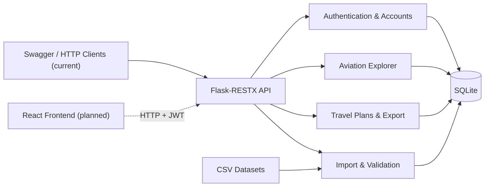
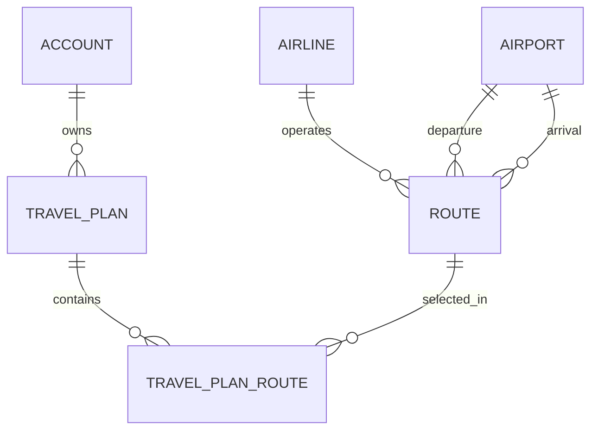

# AirRoute — Project Documentation

> **Product:** Airline Route Explorer & Travel Planner  
> **Tagline:** Explore airline networks. Organise your travel plans.  
> **Status:** REST backend implemented and tested; lightweight React frontend planned.

## 1. Project Goal

- **Problem:** Raw airport, airline and route datasets are difficult to explore. Users also need a straightforward way to organise selected routes into personal travel plans.
- **Target Users:**
  - **User:** Explore aviation data; create, manage and export their own travel plans.
  - **Admin:** Do the same for their own plans, plus manage accounts and import aviation datasets. Admins cannot access other users' private plans.
- **Goal:** Build a lightweight full-stack application for exploring aviation route networks and managing personal travel plans.
- **MVP Scope:** Searchable aviation catalogue, authenticated personal plans, validated CSV imports, JSON/PNG exports, documented REST API and a small web interface.
- **Non-goals:** Live schedules, real-time fares, ticket booking, payments, AI assistance, Google Maps and production-scale infrastructure.

**Data boundary:** The current aviation records are **CSV-imported demonstration data**, not a live airline service. Integration with an external aviation-data provider is a possible future extension, not a feature of this MVP.

## 2. Requirements

| ID | Feature | Priority | Acceptance Criteria | Status |
| --- | --- | --- | --- | --- |
| R1 | Authentication & Account Management | Must | JWT login; Admin account management; active-account and role checks; private plans remain private, including after account deletion. | Backend complete |
| R2 | Aviation Data Import | Must | Admin can import airport, airline and route CSV files; invalid imports roll back; routes referenced by plans cannot be removed or changed. | Backend complete |
| R3 | Aviation Explorer | Must | Authenticated users can browse, search, filter and inspect airports, airlines and routes, including related records. | Backend complete |
| R4 | Personal Travel Plans | Must | Users can create, list, view, update and delete their own plans; add/remove existing routes; validate date ranges and ownership. | Backend complete |
| R5 | Export | Must | Export only the current account's plans as self-contained JSON; display a PNG timeline of up to five nearest future plans; handle empty results. | Backend complete |
| R6 | API Documentation & Testing | Must | Document operations in Swagger/OpenAPI and verify normal, invalid and unauthorised requests with automated tests. | Backend complete |
| R7 | Lightweight Web Frontend | Must | React UI supports login, aviation search and basic plan management through real existing API endpoints. | Planned |

**Frontend scope (time-boxed):**

- **P0:** Login, airport/airline/route browsing and search, basic travel-plan CRUD.
- **P1, if time permits:** Add/remove routes, JSON/PNG export controls, CSV import and Admin account management.
- **Quality bar:** No mock aviation results, no invented endpoints, and clear labelling of demonstration data.

## 3. Technical Design

### 3.1 Technology Stack

| Area | Technology | Status |
| --- | --- | --- |
| Frontend | React, TypeScript, Vite, Tailwind CSS | Planned |
| Backend / REST | Python, Flask, Flask-RESTX | Implemented |
| Authentication | JWT (Flask-JWT-Extended), hashed passwords | Implemented |
| Database | SQLite, SQLAlchemy / Flask-SQLAlchemy | Implemented |
| Visualisation | Matplotlib (PNG timeline) | Implemented |
| Testing | pytest, requests | Implemented |
| Deployment | Local development; public deployment not required for MVP | Local only |

### 3.2 High-Level Architecture



### 3.3 Modules & Project Structure

The backend currently lives primarily in one Python file. The table describes **logical modules**, not separate files that already exist.

| Module | Responsibility | Current / Planned Location |
| --- | --- | --- |
| Authentication & Accounts | JWT login, roles, account management | `z5596858_api.py` / later `backend/` |
| Aviation Catalogue | Airport, airline and route queries | `z5596858_api.py` / later `backend/` |
| Data Import | CSV parsing, validation and transactional replacement | `z5596858_api.py` / later `backend/` |
| Travel Plans | Ownership, plan CRUD, route associations | `z5596858_api.py` / later `backend/` |
| Export | JSON and PNG generation | `z5596858_api.py` / later `backend/` |
| Web UI | Browser-based interaction with the existing API | `frontend/` (planned) |
| Tests | HTTP integration and isolated unit tests | `z5596858_tests.py`, `z5596858_test_unit.py` |

**Documentation rule:** Record major modules and key entry points only. Update this section and the architecture diagram when responsibilities or module relationships change—not whenever a file or function changes.

### 3.4 Database Design

**Core entities:** `Account`, `Airport`, `Airline`, `Route`, `TravelPlan`, `TravelPlanRoute`.



- **Ownership:** Each travel plan belongs to one account. Only its owner can access or modify it, including when the owner is an Admin.
- **Many-to-many:** A plan contains multiple routes; a route can appear in multiple plans. `TravelPlanRoute` is the junction table with a composite primary key (`plan_id`, `route_id`).
- **Integrity:** Plan return date cannot precede departure date. Duplicate route associations are rejected. CSV imports are atomic and protect routes already referenced by travel plans.
- **Implementation note:** The airline/airport connections shown above are **logical references** validated by application code; the original `Route` model does not declare database foreign keys for those IDs.

### 3.5 Design Decisions (ADR Lite)

#### D001 — SQLite + SQLAlchemy

- **Decision:** Store data locally in SQLite and access it using SQLAlchemy.
- **Reason:** Simple setup and persistence for a small self-contained application.
- **Alternatives:** PostgreSQL or MySQL.
- **Trade-off:** Limited concurrency and deployment flexibility compared with a server database.

#### D002 — Flask-RESTX REST API

- **Decision:** Use Flask-RESTX with Swagger/OpenAPI documentation.
- **Reason:** A small HTTP API with explicit endpoint contracts and interactive documentation.
- **Alternatives:** FastAPI, Django REST Framework.
- **Trade-off:** Request validation and service separation require deliberate implementation.

#### D003 — JWT Authentication and Per-Account Ownership

- **Decision:** Use JWT for protected API calls and enforce ownership on each plan query or mutation.
- **Reason:** Separate account administration from users' private travel data.
- **Alternatives:** Server-side sessions.
- **Trade-off:** Token expiry and account-state changes require additional handling.

#### D004 — Controlled CSV Import

- **Decision:** Validate CSV datasets and replace data transactionally, preserving referenced routes.
- **Reason:** Prevent partial imports and unexpected changes to saved travel plans.
- **Alternatives:** Direct edits or live third-party API synchronisation.
- **Trade-off:** Imported datasets require manual updates and do not represent live flight information.

#### D005 — Route Junction Table

- **Decision:** Model saved routes using `TravelPlanRoute` rather than embedding route IDs in a plan field.
- **Reason:** Support many-to-many relationships and prevent duplicate plan-route pairs.
- **Alternatives:** Serialised route-ID lists or copying route records into plans.
- **Trade-off:** Additional joins and referential-integrity checks.

## 4. API Design

See **[API Reference](API.md)** for methods, endpoints, permissions and error handling. Swagger/OpenAPI is the detailed source of truth for request and response schemas.

*`API.md` is to be written during the API documentation step; it is not yet part of this deliverable.*

## 5. Testing & Delivery

- **Unit Tests:** Isolated pytest tests for validation, database rules and export boundaries.
- **API / Integration Tests:** `requests`-based HTTP tests for authentication, imports, exploration, travel plans, exports and failure cases. The latest local Agent verification reported **48/48 unit tests and 143/143 HTTP tests passing** against a temporary SQLite database.
- **Manual Acceptance Checks:** Log in; browse an airport, airline and route; create a plan; add a route; export JSON/PNG; confirm cross-account privacy; verify PNG display.
- **How to Run (current backend):**

  ```bash
  python -m pip install -r requirements.txt
  python z5596858_api.py
  # In another terminal, with the server running:
  python -m pytest z5596858_tests.py -q
  ```

  Swagger UI: `http://127.0.0.1:5000/`. Run database-changing HTTP tests against an isolated database rather than development data.

- **Definition of Done:** Frontend P0 actions work against the actual API; README has reproducible setup instructions and screenshots; the project can be listed as a completed Side Project.
- **Known Limitations:** Imported demo data only; no live flight schedules, fares or booking; frontend not yet implemented; local runtime is the primary target.
- **Delivery Rule:** Preserve the original coursework submission. Perform refactoring and frontend work in a separate Side Project branch or copy, keeping existing endpoint behaviour and tests intact.
